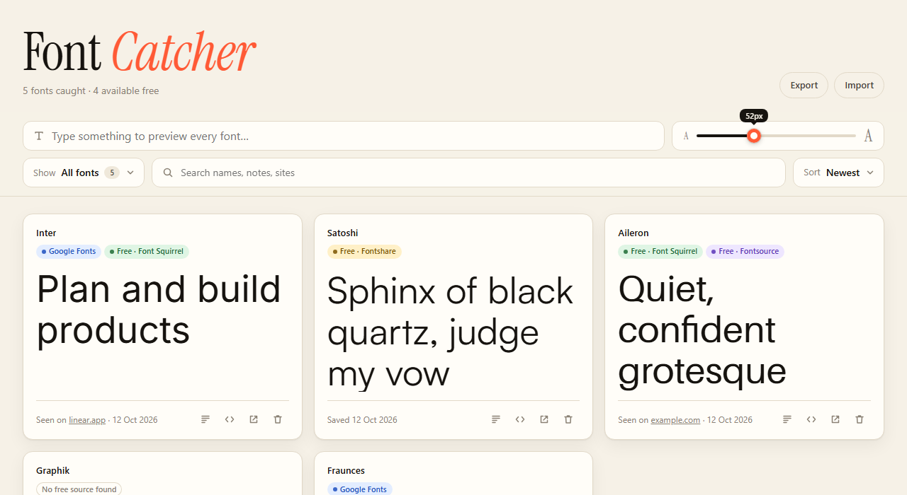
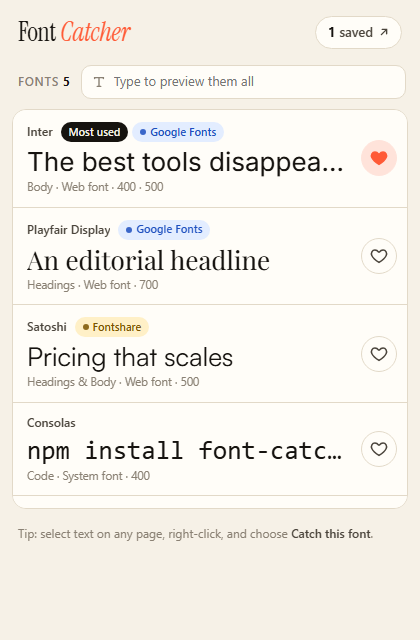
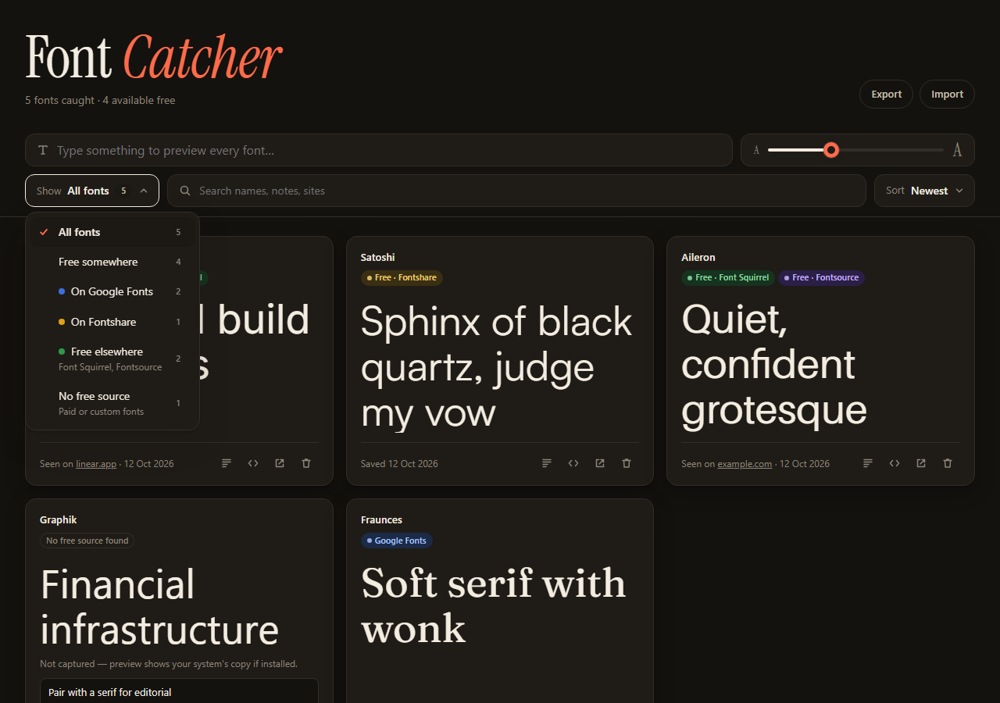
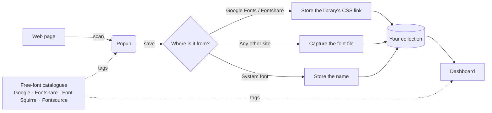

<div align="center">


# Font Catcher

**Catch fonts you love anywhere on the web, and find out where to get them for free.**

Heart fonts on Google Fonts and Fontshare, grab fonts from any website,<br>
and keep them all in one dashboard where each font is previewed in its own typeface.




</div>

---

## Contents

- [Features](#features)
- [Install from this repository](#install-from-this-repository)
- [How to use it](#how-to-use-it)
- [Updating](#updating)
- [How it works](#how-it-works)
- [Privacy & permissions](#privacy--permissions)
- [Troubleshooting](#troubleshooting)
- [Project structure](#project-structure)
- [Contributing](#contributing)

## Features

| | |
| --- | --- |
| ♥ **Hearts on font libraries** | Google Fonts and Fontshare get a **Save font** button on every font page and a ♥ on every font card. |
| 🔍 **Catch fonts on any site** | Open the popup to see **every font on the page**, each previewed in its own typeface and ranked by how much text uses it. |
| ✍️ **Preview them all** | Type your own text once and see it in every font on the page, or every font in your collection. |
| 🖱️ **Right-click to catch** | Select text anywhere → right-click → **Catch this font**. |
| 🆓 **Free-source finder** | Every font is checked against **Google Fonts, Fontshare, Font Squirrel and Fontsource** and tagged with each place you can get it free. |
| 🗂️ **Dashboard** | Search, filter by free source, sort, add notes, copy ready-to-use CSS, and export or import your collection. |
| 🧹 **Smart names** | Coded names like `__Inter_d65c78` (from Next.js sites) or `PlusJakartaSans-Variable` are cleaned up to **Inter** and **Plus Jakarta Sans**. |
| 🌗 **Light & dark** | Follows your system theme. |

<table>
  <tr>
    <td width="38%" valign="top"><br><sub><b>Popup:</b> every font on the page, previewed and tagged</sub></td>
    <td width="62%" valign="top"><br><sub><b>Dashboard:</b> filter by where a font is free</sub></td>
  </tr>
</table>

## Install from this repository

Font Catcher isn't on the Chrome Web Store yet, so you load it straight from this repo. It takes about a minute, and there's nothing to build or `npm install`.

### 1. Get the code

**With Git:**

```bash
git clone https://github.com/<your-username>/font-catcher.git
```

**Without Git:** click the green **Code** button at the top of this page → **Download ZIP**, then unzip it somewhere you'll keep it. Chrome loads the extension from that folder, so don't delete it afterwards.

### 2. Load it into your browser

**Chrome, Brave, Arc or other Chromium browsers**

1. Go to `chrome://extensions`.
2. Turn on **Developer mode** (top-right toggle).
3. Click **Load unpacked**.
4. Select the `font-catcher` folder, the one that contains `manifest.json`.

**Microsoft Edge**

1. Go to `edge://extensions`.
2. Turn on **Developer mode** (left sidebar).
3. Click **Load unpacked** and select the `font-catcher` folder.

### 3. Pin it

Click the puzzle-piece icon in the toolbar and pin **Font Catcher** so the ♥ icon is always one click away.

> [!NOTE]
> Chrome may show a **"Disable developer mode extensions"** banner when it starts. That's normal for extensions loaded from source; click ✕ to dismiss it.

## How to use it

### Save fonts on Google Fonts & Fontshare

1. Open any font, e.g. [fonts.google.com/specimen/Inter](https://fonts.google.com/specimen/Inter) or [fontshare.com/fonts/satoshi](https://www.fontshare.com/fonts/satoshi).
2. Click the floating **♡ Save font** button in the bottom-right corner. It turns into **♥ Saved**.
3. While browsing, use the small ♥ on each font card to save fonts without opening them.

Click a ♥ again to remove the font.

### Catch fonts on any website

1. Visit any site whose typography you like.
2. Click the Font Catcher icon (or press <kbd>Alt</kbd> + <kbd>Shift</kbd> + <kbd>F</kbd>).
3. The popup lists **every font on the page**:
   - each row shows the page's own text in that font
   - the font used most is tagged **Most used**
   - tags show where it's free (**Google Fonts**, **Fontshare**, **Font Squirrel**, **Fontsource**), or **No free source**
   - fonts the page loads but isn't showing right now (menus, tabs, pop-ups) appear at the bottom
4. Type in **"Type to preview them all"** to see your own words in every font.
5. Click ♡ on any font to save it.

> [!TIP]
> **Want one specific font?** Select some text set in it before opening the popup, and it'll appear at the top under **Your selection**. Or skip the popup: select the text, right-click, and choose **Catch this font**.

### Use the dashboard

Click **"N saved ↗"** in the popup, or right-click the toolbar icon → **Open font dashboard**.

| Want to… | Do this |
| --- | --- |
| Preview your own text | Type in the top field. It's applied to every card. |
| Change preview size | Drag the size slider. |
| See only free fonts | **Show** → *Free somewhere*, *On Google Fonts*, *On Fontshare* or *Free elsewhere*. |
| Find paid or custom fonts | **Show** → *No free source*. |
| Reorder | **Sort** → *Newest*, *Oldest* or *Name A–Z*. |
| Get the free version | Click a coloured tag on the card (e.g. **Google Fonts**) to open the font there. |
| Use it in your project | Click **`< >`** to copy CSS (`@import` + `font-family`). |
| Remember why you saved it | Click the notes icon and type. Notes are searchable. |
| See where you found it | The card footer shows **Seen on** *site.com*. Click to revisit. |
| Back up or move computers | **Export** downloads a `.json` file (fonts, notes and captured files). **Import** brings it back. |

## Updating

When this repo gets new commits:

```bash
cd font-catcher
git pull
```

Then go to `chrome://extensions` and click the **↻ reload** icon on Font Catcher. Your saved fonts are kept, because they live in the browser, not in this folder.

If you downloaded the ZIP instead, download the new ZIP, replace the folder contents, and click reload.

## How it works



- **Finding fonts:** the popup checks which font is actually shown for each piece of text on the page, so it reports what you're seeing, not just the first name the page's CSS lists.
- **Keeping previews working:** fonts from Google Fonts or Fontshare are saved as a link to that library. For other sites, Font Catcher saves the font file itself (the weight closest to Regular, up to 4 MB), so the preview still works after you leave the site.
- **Free-source check:** the catalogues of the four free libraries are downloaded once, compacted to about 110 KB, and refreshed weekly, so each check is instant and works offline. If a font couldn't be captured but a free copy exists, the dashboard previews it with that copy.
- **No duplicates:** fonts are matched by their cleaned-up name, so catching *Inter* on five different sites gives one card that lists all five sites.

## Privacy & permissions

**Everything stays in your browser.** There's no account, no server and no analytics. Your collection lives in `chrome.storage.local` on your device.

Font Catcher only connects to the internet to:
- fetch fonts and stylesheets from the sites you catch fonts on, for previews
- read public font catalogues from Google Fonts, Fontshare, Font Squirrel and Fontsource

| Permission | Why it's needed |
| --- | --- |
| `<all_urls>` (read site data) | Sites often load their fonts' CSS from other servers that the page's own scripts can't read. This permission lets Font Catcher read those stylesheets and download the font files for previews. |
| `activeTab`, `scripting` | Scan the current page when you open the popup or use **Catch this font**. |
| `storage`, `unlimitedStorage` | Store your collection and captured font files on your device. |
| `contextMenus` | Add the **Catch this font** right-click option. |

> [!IMPORTANT]
> Capturing a font lets you **preview** it. It doesn't give you a **licence** to use it. The free-source tags tell you where you can get a font legitimately. For anything tagged **No free source**, check the foundry's licence before using it.

## Troubleshooting

<details>
<summary><b>The popup says it "can't read this page"</b></summary>

Browsers block all extensions on internal pages (`chrome://…`, `edge://…`), the Chrome Web Store, and some built-in PDF viewers. Try a regular website.
</details>

<details>
<summary><b>A font's preview shows a fallback font</b></summary>

Some fonts can't be downloaded. Adobe Fonts (Typekit), for example, only serve their files to the site that licensed them. Font Catcher still saves the name and where you found it, and if a free copy exists anywhere, the dashboard uses that for the preview instead.
</details>

<details>
<summary><b>No ♥ buttons on Google Fonts / Fontshare cards</b></summary>

Both sites change their layout from time to time. The **Save font** button on a font's own page still works, and so does the popup. Please [open an issue](../../issues) if the card hearts stop appearing.
</details>

<details>
<summary><b>Free-source tags are missing or stay grey</b></summary>

The free-font catalogues download in the background. If you were offline, or a service was down, fonts are checked again the next time you open the dashboard.
</details>

<details>
<summary><b>The keyboard shortcut doesn't work</b></summary>

Another extension may already use <kbd>Alt</kbd> + <kbd>Shift</kbd> + <kbd>F</kbd>. Change it at `chrome://extensions/shortcuts`.
</details>

<details>
<summary><b>I changed the code but nothing happened</b></summary>

Click **↻ reload** on the extension card in `chrome://extensions`, then reload the web page you're testing on. Content scripts only attach to pages loaded after the extension reloads.
</details>

## Project structure

```
font-catcher/
├── manifest.json               # Extension manifest (MV3)
├── icons/                      # Toolbar & store icons
├── docs/images/                # README screenshots
└── src/
    ├── background.js           # Saving, de-duplication, right-click menu
    ├── content/
    │   └── site-hearts.js      # ♥ buttons on fonts.google.com & fontshare.com
    ├── popup/                  # Toolbar popup (fonts on the current page)
    ├── dashboard/              # Your collection
    ├── lib/
    │   ├── detect.js           # Page scanner, injected into the tab
    │   ├── resolve.js          # Where a font comes from; captures font files
    │   ├── availability.js     # Free-source lookup (4 libraries)
    │   ├── names.js            # "__Inter_d65c78" → "Inter"
    │   └── store.js            # Storage helpers
    └── ui/
        ├── base.css            # Shared design tokens (light/dark)
        ├── tags.js             # Free-source tags
        └── dropdown.js         # Accessible dropdown component
```

## Contributing

It's plain JavaScript modules, with no framework, bundler or dependencies.

1. Fork and clone the repo, then load it unpacked (see [Install](#install-from-this-repository)).
2. Edit the files in `src/`.
3. Reload the extension in `chrome://extensions` to see your changes.
4. Debug:
   - **Popup:** right-click the toolbar icon → *Inspect popup*.
   - **Background worker:** click *service worker* on the extension card.
   - **Dashboard:** it's a normal tab, so use DevTools.

Ideas and bug reports are welcome in [Issues](../../issues).

<div align="center">
<br>
<sub>Made for people who stop scrolling to stare at a nice <i>g</i>.</sub>
</div>
